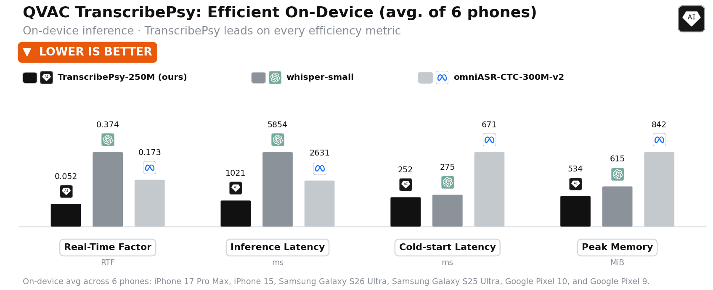
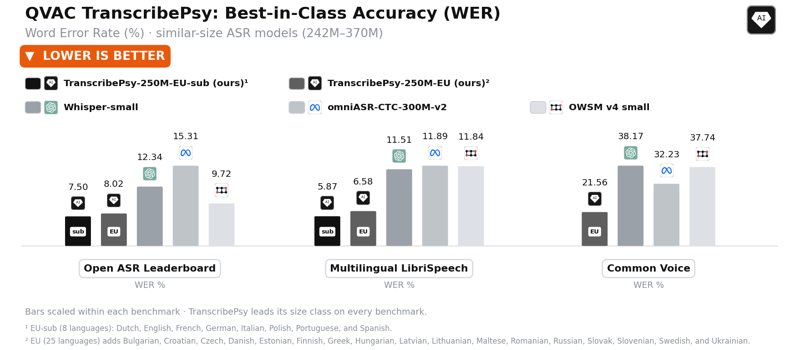
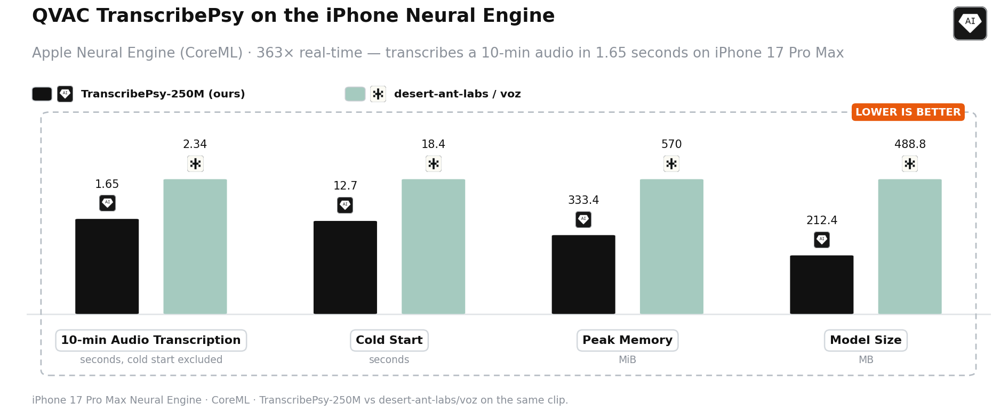

<div align="center">

[](#-models)
[](#-what-it-does)
[](#-models)
[](LICENSE)
[](CMakeLists.txt)

# QVAC TranscribePsy

**Multilingual automatic speech recognition (ASR) that runs on the phone in your pocket**<br>
**The on-device engine for TranscribePsy: GGUF on the CPU, Core ML on the Apple Neural Engine**

[](https://huggingface.co/qvac/TranscribePsy-250M-EU)
[](https://huggingface.co/qvac/TranscribePsy-250M-EU-sub)
[](https://huggingface.co/qvac/TranscribePsy-250M-EU-sub-gguf)
[](https://huggingface.co/qvac/TranscribePsy-250M-EU-sub-coreml)

[](https://huggingface.co/blog/qvac/transcribepsy-250m)

[](https://arxiv.org/abs/2610.19134)

[Models](#-models) •
[Benchmarks](#-benchmarks) •
[Quick Start](#-quick-start) •
[Reproducing](#-reproducing-the-release-files) •
[Repository Structure](#-repository-structure) •
[Requirements](#-requirements-at-a-glance) •
[License](#-license)



<em>Averaged over six phones, TranscribePsy is the fastest, the lightest on memory and the quickest to load.</em>

</div>

---

## 🎯 What It Does

**TranscribePsy** is a 254M-parameter FastConformer transducer distilled from NVIDIA's
[Parakeet-TDT-0.6B-v3](https://huggingface.co/nvidia/parakeet-tdt-0.6b-v3). This repository is the
C++ engine that runs it on the device: one code base for the CPU of Android phones, iPhones, Macs
and Linux machines, and for the Apple Neural Engine.

### ⚡ Fastest on every phone we tested

Across six phones the GGUF build averages a **0.052 real-time factor**, **1,021 ms** per
utterance, a **252 ms** cold start and **534 MiB** peak memory @ 10s. Its latency per utterance is 2.6×
lower than that of the next-fastest model tested and 5.7× lower than Whisper-small's.

### 🍎 Ten minutes of audio in 1.65 seconds

On the Neural Engine of an iPhone 17 Pro Max, with both the encoder and the decoder on the
Neural Engine, the Core ML build transcribes a 10-minute recording in 1.65 seconds of pure
transcription inference time, 363 times faster than real time, after a cold start of 12.7 seconds.

### 📦 Nothing to fetch at build time

ggml is vendored at a pinned commit, and a model is one GGUF file, or three files for Core ML.
No Python is needed at run time.

---

## 📦 Models

The model weights are released on the Hugging Face Hub:

| Model | What it's for | Format | Link |
| --- | --- | --- | --- |
| 🪶 **TranscribePsy-250M-EU-sub-gguf** | **On-device CPU** with this engine: Android, iOS, macOS, Linux | GGUF Q8_0, 305 MB | [qvac/TranscribePsy-250M-EU-sub-gguf](https://huggingface.co/qvac/TranscribePsy-250M-EU-sub-gguf) |
| 🍎 **TranscribePsy-250M-EU-sub-coreml** | **Apple Neural Engine** with this engine | Core ML, 212.4 MB | [qvac/TranscribePsy-250M-EU-sub-coreml](https://huggingface.co/qvac/TranscribePsy-250M-EU-sub-coreml) |
| 🏆 **TranscribePsy-250M-EU-sub** | **Best accuracy** on its eight languages, GPU or server | PyTorch (NeMo) | [qvac/TranscribePsy-250M-EU-sub](https://huggingface.co/qvac/TranscribePsy-250M-EU-sub) |
| 🌍 **TranscribePsy-250M-EU** | **Broadest coverage**: 25 European languages, GPU or server | PyTorch (NeMo) | [qvac/TranscribePsy-250M-EU](https://huggingface.co/qvac/TranscribePsy-250M-EU) |

The on-device builds are TranscribePsy-250M-EU-sub. One set of weights covers all eight of its
languages, so there is no language to set. Accuracy, architecture and training are described in
the model cards.

### 🗣️ Supported languages

| Model | Languages | Chosen to match |
| --- | --- | --- |
| 🏆 **TranscribePsy-250M-EU-sub**, with its GGUF and Core ML builds | **8**: Dutch `nl`, English `en`, French `fr`, German `de`, Italian `it`, Polish `pl`, Portuguese `pt`, Spanish `es` | The eight languages of [Multilingual LibriSpeech](https://www.openslr.org/94/) |
| 🌍 **TranscribePsy-250M-EU** | **25**: the eight above, plus Bulgarian `bg`, Croatian `hr`, Czech `cs`, Danish `da`, Estonian `et`, Finnish `fi`, Greek `el`, Hungarian `hu`, Latvian `lv`, Lithuanian `lt`, Maltese `mt`, Romanian `ro`, Russian `ru`, Slovak `sk`, Slovenian `sl`, Swedish `sv`, Ukrainian `uk` | The 25 languages of [Parakeet-TDT-0.6B-v3](https://huggingface.co/nvidia/parakeet-tdt-0.6b-v3), the teacher it is distilled from |

---

## 📊 Benchmarks

### Accuracy

Word error rate (%), lower is better. Every model is decoded and scored with the same pipeline and
the official Open ASR Leaderboard text normalizer. Bold marks the best score in each column.

| Model | Params | Open ASR Leaderboard | Multilingual LibriSpeech | Common Voice v25 |
| --- | --- | --- | --- | --- |
| 🏆 **TranscribePsy-250M-EU-sub** | 254M | **7.50** | **5.87** | n/a ¹ |
| 🌍 **TranscribePsy-250M-EU** | 254M | 8.02 | 6.58 | **21.56** |
| Whisper-small | 242M | 12.34 | 11.51 | 38.17 |
| omniASR-CTC-300M-v2 | 326M | 15.31 | 11.89 | 32.23 |
| OWSM v4 small | 370M | 9.72 | 11.84 | 37.74 |

¹ Common Voice is the mean over its 24 languages; the 8-language model has no comparable mean.

<p align="center">
  
</p>

Against models three to four times its size, TranscribePsy-250M-EU still has the lowest
Multilingual LibriSpeech error: **6.58**, against 7.71 for omniASR-CTC-1B-v2, 7.76 for
Whisper-Medium, 10.65 for OWSM-CTC-v4 and 12.60 for Qwen3-ASR-0.6B. Per-dataset results are in the
[TranscribePsy-250M-EU](https://huggingface.co/qvac/TranscribePsy-250M-EU) and
[TranscribePsy-250M-EU-sub](https://huggingface.co/qvac/TranscribePsy-250M-EU-sub) model cards.

### 📱 Phone CPU, GGUF build

160 utterances drawn at random from Multilingual LibriSpeech, 20 per language across eight
languages, 40 minutes of audio in total. Every model runs as an 8-bit build under
the same test settings, and every figure is the mean of the best three of five runs.

**Average over six phones**

| Model | Real-time factor | Latency per utterance | Cold start | Peak memory @ 10s |
| --- | --- | --- | --- | --- |
| **TranscribePsy-250M-EU-sub** (this engine) | **0.052** | **1,021 ms** | **252 ms** | **534 MiB** |
| omniASR-CTC-300M-v2 | 0.173 | 2,631 ms | 671 ms | 842 MiB |
| Whisper-small | 0.374 | 5,854 ms | 275 ms | 615 MiB |
| Qwen3-ASR-0.6B | 0.462 | 7,616 ms | 677 ms | 1,169 MiB |
| Whisper-Medium | 0.931 | 14,636 ms | 870 ms | 1,569 MiB |
| omniASR-CTC-1B-v2 | 0.998 | 15,372 ms | 898 ms | 1,275 MiB |

**TranscribePsy per device**

| Device | SoC | Latency per utterance | Cold start | Peak memory @ 10s |
| --- | --- | --- | --- | --- |
| Galaxy S26 Ultra | 8 Elite Gen5 | 633 ms | 213 ms | 530 MiB |
| Galaxy S25 Ultra | 8 Elite | 771 ms | 241 ms | 533 MiB |
| iPhone 17 Pro Max | A19 Pro | 1,059 ms | 153 ms | 542 MiB |
| iPhone 15 | A16 | 854 ms | 221 ms | 537 MiB |
| Pixel 10 | Tensor G5 | 1,240 ms | 327 ms | 530 MiB |
| Pixel 9 | Tensor G4 | 1,570 ms | 356 ms | 530 MiB |

It is the fastest model on each of these phones. The
[GGUF model card](https://huggingface.co/qvac/TranscribePsy-250M-EU-sub-gguf) has the per-device
comparison with every model.

### 🍎 Apple Neural Engine, Core ML build

iPhone 17 Pro Max, against
[desert-ant-labs/voz](https://huggingface.co/desert-ant-labs/voz), on the same audio:

<p align="center">
  
</p>

| | TranscribePsy Core ML | voz |
| --- | --- | --- |
| 10-minute recording, transcription inference time only | **1.65 s** | 2.34 s |
| 40-minute test set above, transcription time | **32.8 s** | 39.9 s |
| Average latency per utterance | **207.3 ms** | 253.4 ms |
| Peak memory, 10-minute recording | **333.4 MiB** | 570 MiB |
| Model size | **212.4 MB** | 488.8 MB |

Transcription times exclude the cold start. On the Neural Engine the cold start includes Core ML's
one-time model compilation on the device: 12.7 s against 18.4 s for voz on the 10-minute recording,
and 12.4 s against 18.6 s on the 40-minute set.

---

## 🚀 Quick Start

| Path | Best for | Model |
| --- | --- | --- |
| ⚡ **One command** | Trying it on your own recordings | downloaded for you |
| 🛠️ **Command-line engine** | Scripts and servers on Linux or macOS | [GGUF](https://huggingface.co/qvac/TranscribePsy-250M-EU-sub-gguf) |
| 🍎 **Apple Neural Engine** | Macs and iPhones with Apple silicon | [Core ML](https://huggingface.co/qvac/TranscribePsy-250M-EU-sub-coreml) |
| 📱 **In an app** | iOS and Android integration through the C++ API | GGUF or Core ML |
| 🐍 **PyTorch (NeMo)** | GPU evaluation and fine-tuning, without this engine | [EU-sub](https://huggingface.co/qvac/TranscribePsy-250M-EU-sub) · [EU](https://huggingface.co/qvac/TranscribePsy-250M-EU) |

### ⚡ One command

On Linux or macOS:

```bash
git clone https://github.com/tether-ai-research/qvac-transcribePsy.git
cd qvac-transcribePsy
pipx install huggingface_hub        # or, in a virtual environment: pip install -U huggingface_hub

scripts/transcribe.sh recording.m4a
scripts/transcribe.sh --coreml recording.m4a # Apple Neural Engine, on a Mac
```

The script downloads the model with the `hf` command, which it looks for on `PATH`. If you
installed `huggingface_hub` in a virtual environment, activate it before each run of
`scripts/transcribe.sh`.

The first run builds the engine and downloads the model into `models/`; later runs rebuild the
engine only if its sources have changed. Any format ffmpeg reads is accepted; without ffmpeg, pass
16 kHz mono WAV. Pass several files to get one transcript per line.
`--window-sec` and `--overlap` are passed on to the command-line engine, described next.

### 🛠️ Command-line engine

```bash
cmake -S . -B build -DCMAKE_BUILD_TYPE=Release
cmake --build build -j

hf download qvac/TranscribePsy-250M-EU-sub-gguf \
  transcribepsy-250m-eu-sub.gguf --local-dir models

ffmpeg -i input.m4a -ar 16000 -ac 1 audio.wav      # the engine takes 16 kHz mono WAV
./build/parakeet --model models/transcribepsy-250m-eu-sub.gguf --wav audio.wav --threads 6
```

The transcript goes to stdout; `--verbose` adds per-stage timings on stderr.

#### Long recordings

Recordings of 60 s or longer are encoded in 60 s windows that overlap by 25 %, so the encoder's
memory depends on the window rather than on the length of the recording; shorter ones are encoded
in one pass. Given the limited memory of phones, we recommend this default for long recordings: on
recordings of 10 to 30 minutes, peak memory stayed below 2 GB in our tests. If that is still too
much for the device, use 30 s windows without overlap: they run faster and use less memory, but are
less accurate at the window boundaries (see the technical report, coming soon).

```bash
# default: 60 s windows, 25 % overlap (same as passing --window-sec 60 --overlap 0.25)
./build/parakeet --model models/transcribepsy-250m-eu-sub.gguf --wav long.wav --threads 6
# or
scripts/transcribe.sh recording.m4a

# faster & less memory: 30 s windows, no overlap; less accurate at window boundaries
./build/parakeet --model models/transcribepsy-250m-eu-sub.gguf --wav long.wav --threads 6 --window-sec 30 --overlap 0
# or
scripts/transcribe.sh --window-sec 30 --overlap 0 recording.m4a
```

`--window-sec S` sets the window, from 20.5 to 400 s, and `--overlap F` the fraction of each
window shared with its neighbours, from 0 to 0.5. `--window-sec 0` encodes the whole recording in
one pass, whose memory grows markedly with its length: in our tests it peaked at about 12 GiB on a
10-minute recording and 53 GiB on a 25-minute one, and a 14-minute recording already needed more
memory than a 16 GB machine has.

### 🍎 Apple Neural Engine

Build with `-DPARAKEET_COREML=ON` and keep the three Core ML files together under their published
names. The engine finds the two `.mlmodelc` bundles by name next to the GGUF.

```bash
cmake -S . -B build -DCMAKE_BUILD_TYPE=Release -DPARAKEET_COREML=ON
cmake --build build -j

hf download qvac/TranscribePsy-250M-EU-sub-coreml --local-dir models/coreml
./build/parakeet --model models/coreml/transcribepsy-250m-eu-sub-coreml.gguf --wav audio.wav
```

The GGUF in the Core ML repository holds no encoder weights, so the engine switches to the Neural
Engine by itself, with no flag to set. Without its `.mlmodelc` files, or on a build without Core ML,
it refuses to load with a message that says why.

With Core ML, `--window-sec` and `--overlap` do not apply, and the two entry points split long
recordings differently. `./build/parakeet` encodes them in fixed 15 s windows that share 1.28 s of
context on each side and decodes the result in one pass. The engine API's `transcribe()` cuts them
at pauses into segments of at most 15 s and encodes and decodes each segment on its own.

### 📱 In an app

The engine has a C++ API. On iOS, call it from an Objective-C++ (`.mm`) file:

```objc
#include <parakeet/engine.h>

parakeet::EngineOptions opts;
opts.model_gguf_path = "/path/to/transcribepsy-250m-eu-sub-coreml.gguf";
parakeet::Engine engine(opts);

parakeet::EngineResult r = engine.transcribe("/path/to/audio.wav");   // 16 kHz mono
NSString *text = [NSString stringWithUTF8String:r.text.c_str()];
```

A long recording is a single `transcribe()` call. With the Core ML models the engine cuts it into
segments at pauses by itself. With the GGUF model, the engine API uses longer windows than the
command-line engine: it encodes recordings of up to 300 s in one pass and longer ones in windows of
up to 300 s that share 20.48 s of context on each side. At this length the encoder peaked at about
6.5 GiB in our tests on a Galaxy S26 Ultra, against under 2 GB for the command-line default. On a
phone, set the window and the context on each side yourself, in 80 ms encoder frames. The two
fields apply to the GGUF model only; with the Core ML models, `transcribe()` cuts at pauses and
does not use them. Set them before constructing the `Engine`: it copies the options, so changing
them afterwards has no effect.

```cpp
parakeet::EngineOptions opts;
opts.model_gguf_path = "/path/to/transcribepsy-250m-eu-sub.gguf";   // GGUF model, CPU
opts.long_form_window_frames  = 750;   // 60 s windows
opts.long_form_context_frames = 94;    // 25 % overlap; -1 for none
parakeet::Engine engine(opts);         // options are copied here; set them first
```

`scripts/build-ios.sh` builds the iOS static library and `scripts/build-android.sh` the
Android command-line tool. **[BUILD.md](BUILD.md)** explains their flags, the Arm ISA extensions
the published measurements depend on, and how to overlap the next file's audio front-end with the
current one when transcribing many files.

### 🐍 PyTorch (NeMo)

The PyTorch checkpoints run with NeMo on a GPU or a CPU, without this engine:

```python
# pip install "nemo_toolkit[asr]"
import nemo.collections.asr as nemo_asr

model = nemo_asr.models.ASRModel.from_pretrained("qvac/TranscribePsy-250M-EU-sub").eval()
print([t.text for t in model.transcribe(["audio_en.wav", "audio_de.wav"])])   # 16 kHz mono
```

The 25-language [TranscribePsy-250M-EU](https://huggingface.co/qvac/TranscribePsy-250M-EU) routes
non-English audio through language adapters; its model card shows how.

---

## 🔁 Reproducing the Release Files

The GGUF is a direct conversion of the published NeMo checkpoint. Converting it reproduces the
published file byte for byte:

```bash
pip install torch numpy gguf sentencepiece pyyaml
hf download qvac/TranscribePsy-250M-EU-sub TranscribePsy-250M-EU-sub.nemo --local-dir models
python scripts/convert-nemo-to-gguf.py \
  --ckpt models/TranscribePsy-250M-EU-sub.nemo \
  --out  models/transcribepsy-250m-eu-sub.gguf --quant q8_0 \
  --description "TranscribePsy-250M-EU-sub, FastConformer-TDT speech recognition"
```

Check the `--ckpt` path: when the file does not exist, the conversion fails.

The Core ML models are exported from that GGUF on macOS with `coremltools`. The published
configuration is a 15 s encoder window, 16 decoder lanes, and 6-bit palettized weights throughout.
The exporters' defaults match it, except that the decoder exporter keeps the joint output
projection in Float16 unless given `--nbits-out 6`, as below.

```bash
python scripts/export-encoder-coreml-ane.py --gguf models/transcribepsy-250m-eu-sub.gguf \
  --out models/transcribepsy-250m-eu-sub-encoder.mlpackage --compile-dir models
python scripts/export-decoder-coreml-ane.py --gguf models/transcribepsy-250m-eu-sub.gguf \
  --out models/transcribepsy-250m-eu-sub-decoder.mlpackage --compile-dir models --nbits-out 6
```

The two `.mlmodelc` bundles work next to the full GGUF under these names. Set
`PARAKEET_COREML_ONLY=1` so that the encoder weights in the GGUF, which the Neural Engine path
never reads, are not loaded; see [BUILD.md](BUILD.md).

---

## 📁 Repository Structure

```
qvac-transcribePsy/
├── README.md                      # This file
├── BUILD.md                       # Linux, macOS, Android and iOS builds; Core ML file layout
├── assets/                        # Figures used in this README
├── CMakeLists.txt, cmake/         # Build and install rules
│
├── include/parakeet/              # Public C++ API
│   └── engine.h                   # Engine, EngineOptions, EngineResult
│
├── src/                           # The engine
│   ├── parakeet_engine.cpp        # Long-form segmentation and transcription
│   ├── parakeet_tdt.cpp           # TDT transducer decoding
│   ├── mel_preprocess.cpp         # Audio front-end (log-mel)
│   └── coreml/                    # 🍎 Core ML encoder and batched decoder for the Neural Engine
│
├── scripts/
│   ├── transcribe.sh              # ⚡ One-command transcription
│   ├── build-ios.sh               # 📱 iOS static library
│   ├── build-android.sh           # 📱 Android command-line tool
│   ├── convert-nemo-to-gguf.py    # NeMo checkpoint → GGUF
│   ├── export-encoder-coreml-ane.py
│   ├── export-decoder-coreml-ane.py   # GGUF → Core ML for the Neural Engine
│   └── ref-encoder-from-gguf.py   # Reference encoder used by the Core ML exporters
│
├── test/                          # Unit tests, no model or audio needed
└── ggml/                          # Vendored ggml, tetherto/qvac-ext-ggml @ 576c9735
```

---

## 📦 Requirements at a Glance

| Target | Toolchain | Hardware |
| --- | --- | --- |
| Linux, macOS (CPU) | CMake ≥ 3.20, a C++17 compiler | x86-64 or arm64 |
| macOS (Neural Engine) | Xcode command-line tools, `-DPARAKEET_COREML=ON`; Core ML needs macOS 15 or later | Apple silicon |
| iOS | Xcode command-line tools; Core ML needs iOS 18 or later | Apple A15 or later |
| Android | Android NDK r27c, API level 28, arm64-v8a | Armv9 CPU (`dotprod`, `i8mm`) |
| PyTorch checkpoints | Python, `nemo_toolkit[asr]` | GPU recommended; CPU works |

`scripts/transcribe.sh` also uses the Hugging Face CLI to download the model, and ffmpeg, if
installed, to read formats other than 16 kHz mono WAV.

---

## ⚠️ Limitations

- **Batch transcription, not streaming.** The engine transcribes complete recordings.
- **`--window-sec` and `--overlap` cover plain transcription.** In the command-line engine,
  `--stream` keeps the engine API's 300 s windows and `--profile` encodes the whole recording in
  one pass, so very long recordings need much more memory in those modes.
- **16 kHz mono WAV input.** The engine does not resample.
- **Core ML needs iOS 18 or macOS 15 or later** and a device with a Neural Engine.
- **Arm builds need `dotprod` and `i8mm`**: Apple A15 or later, or an Armv9 Android CPU.

---

## 📄 License

The engine is licensed under Apache-2.0 ([LICENSE](LICENSE), [NOTICE](NOTICE)). ggml is MIT
([ggml/LICENSE](ggml/LICENSE)). `src/dr_wav.h` is available under the Unlicense or MIT-0, at your
choice. The TranscribePsy model weights are also released under Apache-2.0 and are distributed
separately on Hugging Face; see the model cards.

## 🙏 Acknowledgements

Built on [QVAC parakeet.cpp](https://github.com/tetherto/qvac-fabric-speech.cpp) and
[ggml](https://github.com/ggml-org/ggml), for NVIDIA's
[Parakeet-TDT](https://huggingface.co/nvidia/parakeet-tdt-0.6b-v3) and
[FastConformer](https://arxiv.org/abs/2305.05084) models.

## 📝 Citation

**CAFE, model training and evaluation**

```bibtex
@article{liu2026cafe,
  title={{CAFE}: Confining Feature Distillation to Language-Routed Adapters for Compact Multilingual Automatic Speech Recognition},
  author={Liu, Tianchi and Moratelli, Nicholas and Hashmi, Khurram Azeem and Zolfaghari, Mohammadreza and Jain, Rishabh and Lu, Louis and Park, Chang Dae and Nazir, Amril},
  journal={arXiv preprint arXiv:2610.19134},
  year={2026}
}
```

**Technical report and on-device evaluation**

Coming soon.

## ©️ Copyright

We will take appropriate actions in response to notices of copyright infringement. If you believe
your work has been used or copied in a manner that infringes upon your intellectual property
rights, please email data-apps@tether.io identifying and describing both the copyrighted work and
alleged infringing content.

---

<div align="center">

**Accurate, private, offline speech recognition, small enough to run on the device in your pocket.**

</div>
