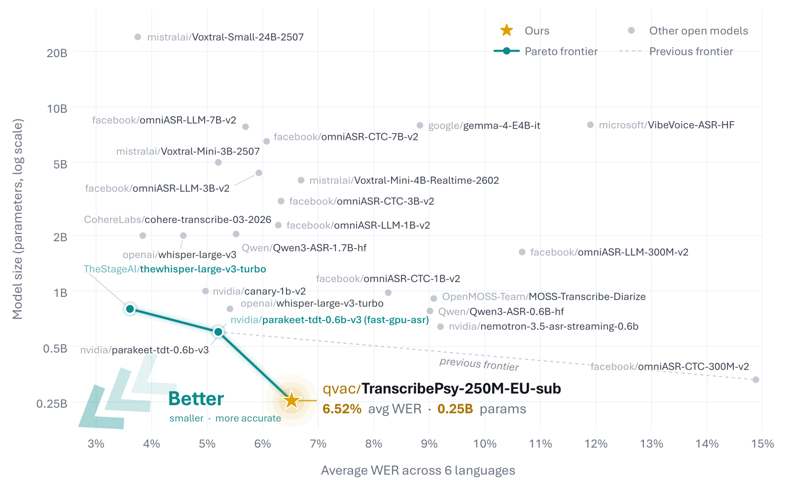
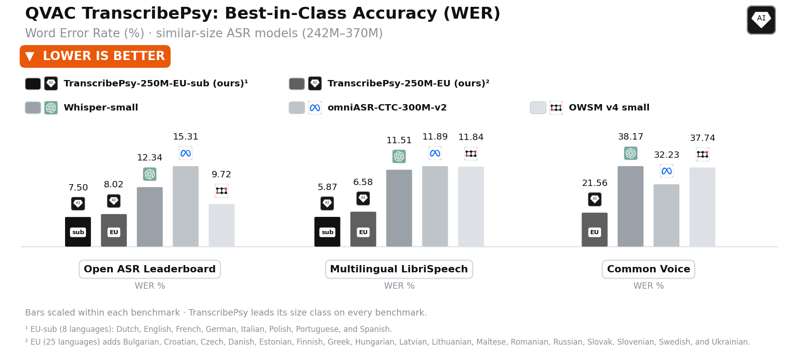
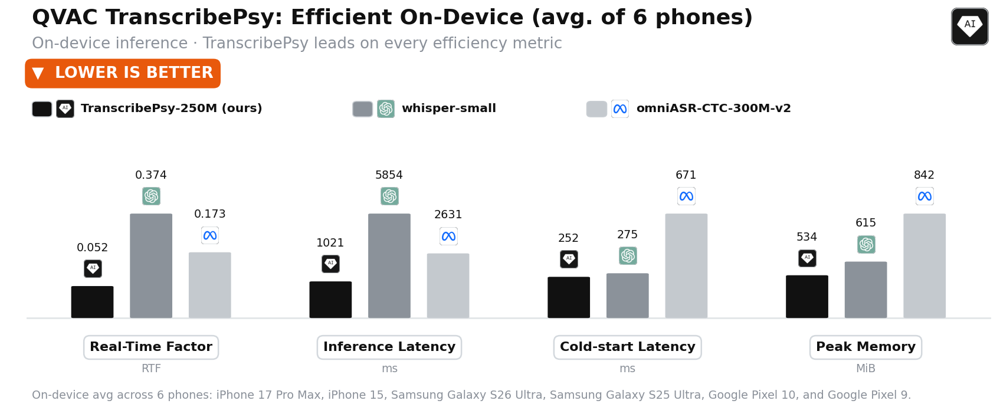
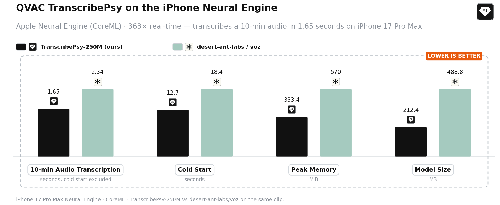

<div align="center">

[](#-models)
[](#-what-it-does)
[](#-models)
[](LICENSE)
[](https://github.com/tetherto/qvac-fabric-speech.cpp)

# QVAC TranscribePsy

**Multilingual automatic speech recognition (ASR) that runs on the phone in your pocket**<br>
**GGUF on the CPU and Core ML on the Apple Neural Engine, through [qvac-fabric-speech.cpp](https://github.com/tetherto/qvac-fabric-speech.cpp)**

[](https://huggingface.co/qvac/TranscribePsy-250M-EU)
[](https://huggingface.co/qvac/TranscribePsy-250M-EU-sub)
[](#-models)
[](#-models)

[](https://huggingface.co/blog/qvac/transcribepsy-250m)

[](https://arxiv.org/abs/2610.19134)

[Models](#-models) •
[Benchmarks](#-benchmarks) •
[Quick Start](#-quick-start) •
[License](#-license)

</div>

---

## 📢 Updates

- [Nov 2026] **TranscribePsy is now supported by [`qvac-fabric-speech.cpp`](https://github.com/tetherto/qvac-fabric-speech.cpp)**, so the engine previously bundled in this repository has been removed.

- [Oct 2026] **[TranscribePsy-250M-EU-sub](https://huggingface.co/qvac/TranscribePsy-250M-EU-sub) is now officially listed on the
  [Open ASR Leaderboard](https://huggingface.co/spaces/hf-audio/open_asr_leaderboard)**, and it is on
  the Pareto frontier of model size and WER in the leaderboard's Multilingual track.

  

  *The plot and all its data are taken from the official leaderboard page
  (retrieved on 26 October 2026, leaderboard version 26-10-2026). The WER (%) is averaged over six
  languages (German, French, Italian, Spanish, Portuguese and Dutch).*

- [Oct 2026] **The paper on CAFE, the language-routed adapter design behind
  [TranscribePsy-250M-EU](https://huggingface.co/qvac/TranscribePsy-250M-EU), is now on
  [arXiv](https://arxiv.org/abs/2610.19134).**

---

## 🎯 What It Does

**TranscribePsy** is a 254M-parameter FastConformer transducer distilled from NVIDIA's
[Parakeet-TDT-0.6B-v3](https://huggingface.co/nvidia/parakeet-tdt-0.6b-v3). It comes in two
versions: **TranscribePsy-250M-EU** covers 25 European languages with CAFE language-routed adapters,
and **TranscribePsy-250M-EU-sub** covers 8. Both are released as PyTorch checkpoints for GPUs and
servers; TranscribePsy-250M-EU-sub is also released as GGUF and Core ML builds for on-device use, and
those of TranscribePsy-250M-EU are coming soon.

The on-device builds run on the
[Parakeet engine](https://github.com/tetherto/qvac-fabric-speech.cpp/tree/master/engines/parakeet) of
[qvac-fabric-speech.cpp](https://github.com/tetherto/qvac-fabric-speech.cpp): one code base for the
CPU of Android phones, iPhones, Macs and Linux machines, and for the Apple Neural Engine. This
repository holds the release notes, the model overview and the benchmarks.

### ⚡ Fastest on every phone we tested

Across six phones the GGUF build averages a **0.052 real-time factor**, **1,021 ms** per
utterance, a **252 ms** cold start and **534 MiB** peak memory @ 10s. Its latency per utterance is 2.6×
lower than that of the next-fastest model tested and 5.7× lower than Whisper-small's.

### 🍎 Ten minutes of audio in 1.65 seconds

On the Neural Engine of an iPhone 17 Pro Max, with both the encoder and the decoder on the
Neural Engine, the Core ML build transcribes a 10-minute recording in 1.65 seconds of pure
transcription inference time, 363 times faster than real time, after a cold start of 12.7 seconds.

---

## 📦 Models

The model weights are released on the Hugging Face Hub:

| Model | What it's for | Format | Link |
| --- | --- | --- | --- |
| 🌍 **TranscribePsy-250M-EU** | **Broadest coverage**: 25 European languages, GPU or server | PyTorch (NeMo) | [qvac/TranscribePsy-250M-EU](https://huggingface.co/qvac/TranscribePsy-250M-EU) |
| 🏆 **TranscribePsy-250M-EU-sub** | **Best accuracy** on its 8 languages, GPU or server | PyTorch (NeMo) | [qvac/TranscribePsy-250M-EU-sub](https://huggingface.co/qvac/TranscribePsy-250M-EU-sub) |
| 🪶 **TranscribePsy-250M-EU-gguf** | **On device**, 25 languages: Android, iOS, macOS, Linux | GGUF Q8_0 | Coming soon |
| 🪶 **TranscribePsy-250M-EU-sub-gguf** | **On device**, 8 languages: Android, iOS, macOS, Linux | GGUF Q8_0, 305 MB | [qvac/TranscribePsy-250M-EU-sub-gguf](https://huggingface.co/qvac/TranscribePsy-250M-EU-sub-gguf) |
| 🍎 **TranscribePsy-250M-EU-coreml** | **Apple Neural Engine**, 25 languages | Core ML | Coming soon |
| 🍎 **TranscribePsy-250M-EU-sub-coreml** | **Apple Neural Engine**, 8 languages | Core ML, 212.4 MB | [qvac/TranscribePsy-250M-EU-sub-coreml](https://huggingface.co/qvac/TranscribePsy-250M-EU-sub-coreml) |

All on-device builds run on [qvac-fabric-speech.cpp](https://github.com/tetherto/qvac-fabric-speech.cpp).
The EU-sub builds cover their 8 languages with one set of weights, so there is no language to
set. The EU builds send English through the bare trunk and the other languages through the CAFE
adapters; see [choosing the language route](#choosing-the-language-route-eu-builds). Accuracy,
architecture and training are described in the model cards.

### 🗣️ Supported languages

| Model | Languages | Chosen to match |
| --- | --- | --- |
| 🏆 **TranscribePsy-250M-EU-sub**, with its GGUF and Core ML builds | **8**: Dutch `nl`, English `en`, French `fr`, German `de`, Italian `it`, Polish `pl`, Portuguese `pt`, Spanish `es` | The 8 languages of [Multilingual LibriSpeech](https://www.openslr.org/94/) |
| 🌍 **TranscribePsy-250M-EU**, with its GGUF and Core ML builds (coming soon) | **25**: the 8 above, plus Bulgarian `bg`, Croatian `hr`, Czech `cs`, Danish `da`, Estonian `et`, Finnish `fi`, Greek `el`, Hungarian `hu`, Latvian `lv`, Lithuanian `lt`, Maltese `mt`, Romanian `ro`, Russian `ru`, Slovak `sk`, Slovenian `sl`, Swedish `sv`, Ukrainian `uk` | The 25 languages of [Parakeet-TDT-0.6B-v3](https://huggingface.co/nvidia/parakeet-tdt-0.6b-v3), the teacher it is distilled from |

---

## 📊 Benchmarks

### Accuracy

Word error rate (%), lower is better. Every model is decoded and scored with the same pipeline and
the official Open ASR Leaderboard text normalizer. Bold marks the best score in each column.

| Model | Params | Open ASR Leaderboard | Multilingual LibriSpeech | Common Voice v25 |
| --- | --- | --- | --- | --- |
| 🏆 **TranscribePsy-250M-EU-sub** | 254M | **7.50** | **5.87** | n/a ¹ |
| 🌍 **TranscribePsy-250M-EU** | 254M | 8.02 | 6.58 | **21.56** |
| Whisper-small | 242M | 12.34 | 11.51 | 38.17 |
| omniASR-CTC-300M-v2 | 326M | 15.31 | 11.89 | 32.23 |
| OWSM v4 small | 370M | 9.72 | 11.84 | 37.74 |

¹ Common Voice is the mean over its 24 languages; the 8-language model has no comparable mean.

<p align="center">
  
</p>

Against models three to four times its size, TranscribePsy-250M-EU still has the lowest
Multilingual LibriSpeech error: **6.58**, against 7.71 for omniASR-CTC-1B-v2, 7.76 for
Whisper-Medium, 10.65 for OWSM-CTC-v4 and 12.60 for Qwen3-ASR-0.6B. Per-dataset results are in the
[TranscribePsy-250M-EU](https://huggingface.co/qvac/TranscribePsy-250M-EU) and
[TranscribePsy-250M-EU-sub](https://huggingface.co/qvac/TranscribePsy-250M-EU-sub) model cards.

### 📱 Phone CPU, GGUF build

160 utterances drawn at random from Multilingual LibriSpeech, 20 per language across 8
languages, 40 minutes of audio in total. Every model runs as an 8-bit build under
the same test settings, and every figure is the mean of the best three of five runs.
See [how the on-device results were measured](#how-the-on-device-results-were-measured).

**Average over six phones**

| Model | Real-time factor | Latency per utterance | Cold start | Peak memory @ 10s |
| --- | --- | --- | --- | --- |
| **TranscribePsy-250M-EU-sub** (GGUF) | **0.052** | **1,021 ms** | **252 ms** | **534 MiB** |
| omniASR-CTC-300M-v2 | 0.173 | 2,631 ms | 671 ms | 842 MiB |
| Whisper-small | 0.374 | 5,854 ms | 275 ms | 615 MiB |
| Qwen3-ASR-0.6B | 0.462 | 7,616 ms | 677 ms | 1,169 MiB |
| Whisper-Medium | 0.931 | 14,636 ms | 870 ms | 1,569 MiB |
| omniASR-CTC-1B-v2 | 0.998 | 15,372 ms | 898 ms | 1,275 MiB |

<p align="center">
  
</p>

<p align="center"><em>Averaged over six phones, TranscribePsy is the fastest, the lightest on memory and the quickest to load.</em></p>

**TranscribePsy per device**

| Device | SoC | Latency per utterance | Cold start | Peak memory @ 10s |
| --- | --- | --- | --- | --- |
| Galaxy S26 Ultra | 8 Elite Gen5 | 633 ms | 213 ms | 530 MiB |
| Galaxy S25 Ultra | 8 Elite | 771 ms | 241 ms | 533 MiB |
| iPhone 17 Pro Max | A19 Pro | 1,059 ms | 153 ms | 542 MiB |
| iPhone 15 | A16 | 854 ms | 221 ms | 537 MiB |
| Pixel 10 | Tensor G5 | 1,240 ms | 327 ms | 530 MiB |
| Pixel 9 | Tensor G4 | 1,570 ms | 356 ms | 530 MiB |

It is the fastest model on each of these phones. The
[GGUF model card](https://huggingface.co/qvac/TranscribePsy-250M-EU-sub-gguf) has the per-device
comparison with every model.

### 🍎 Apple Neural Engine, Core ML build

iPhone 17 Pro Max, against
[desert-ant-labs/voz](https://huggingface.co/desert-ant-labs/voz), on the same audio:

<p align="center">
  
</p>

| | TranscribePsy Core ML | voz |
| --- | --- | --- |
| 10-minute recording, transcription inference time only | **1.65 s** | 2.34 s |
| 40-minute test set above, transcription time | **32.8 s** | 39.9 s |
| Average latency per utterance | **207.3 ms** | 253.4 ms |
| Peak memory, 10-minute recording | **333.4 MiB** | 570 MiB |
| Model size | **212.4 MB** | 488.8 MB |

Transcription times exclude the cold start. On the Neural Engine the cold start includes Core ML's
one-time model compilation on the device: 12.7 s against 18.4 s for voz on the 10-minute recording,
and 12.4 s against 18.6 s on the 40-minute set.

### How the on-device results were measured

The EU-sub phone and Neural Engine results above were measured with the engine previously bundled
in this repository, at commit
[`b3798f2`](https://github.com/tether-ai-research/qvac-transcribepsy/tree/b3798f2333ceb0ff4b94bdfa5ad0c4eda593873a),
with ggml from tetherto/qvac-ext-ggml (branch `speech`, commit `576c9735`). That engine has since
been replaced by qvac-fabric-speech.cpp, whose
[performance notes](https://github.com/tetherto/qvac-fabric-speech.cpp/blob/master/engines/parakeet/docs/performance.md)
compare the two. Results with the current engine will differ.

---

## 🚀 Quick Start

| Path | Best for | Model |
| --- | --- | --- |
| 🛠️ **qvac-fabric-speech.cpp** | Command line, iOS and Android apps, on the CPU or the Apple Neural Engine | GGUF or Core ML |
| 🐍 **PyTorch (NeMo)** | GPU evaluation and fine-tuning | [EU](https://huggingface.co/qvac/TranscribePsy-250M-EU) · [EU-sub](https://huggingface.co/qvac/TranscribePsy-250M-EU-sub) |

### 🛠️ On device, with qvac-fabric-speech.cpp

Building, running and deploying the engine are described in the
[qvac-fabric-speech.cpp](https://github.com/tetherto/qvac-fabric-speech.cpp) documentation:

- [Build](https://github.com/tetherto/qvac-fabric-speech.cpp/blob/master/engines/parakeet/docs/build.md)
- [Command-line tools](https://github.com/tetherto/qvac-fabric-speech.cpp/blob/master/engines/parakeet/docs/cli.md), including the [long-form window flags](https://github.com/tetherto/qvac-fabric-speech.cpp/blob/master/engines/parakeet/docs/cli.md#long-form-window-flags)
- [C++ API](https://github.com/tetherto/qvac-fabric-speech.cpp/blob/master/engines/parakeet/docs/api.md)
- [TranscribePsy guide](https://github.com/tetherto/qvac-fabric-speech.cpp/blob/master/engines/parakeet/docs/models.md#transcribepsy)
- [Neural Engine sidecars](https://github.com/tetherto/qvac-fabric-speech.cpp/blob/master/engines/parakeet/docs/backends.md#neural-engine-fixed-window-encoder-and-tdt-decoder-sidecars), for TranscribePsy-250M-EU-sub-coreml
- [TranscribePsy-EU Core ML guide](https://github.com/tetherto/qvac-fabric-speech.cpp/blob/master/engines/parakeet/docs/transcribepsy-eu-coreml.md), for Core ML builds of the 25-language TranscribePsy-250M-EU

Download an EU-sub build from the Hub:

```bash
# GGUF
hf download qvac/TranscribePsy-250M-EU-sub-gguf transcribepsy-250m-eu-sub.gguf --local-dir models

# Core ML: keep the files of each repository together under their published names
hf download qvac/TranscribePsy-250M-EU-sub-coreml --local-dir models/eu-sub-coreml
```

The Core ML builds need an engine built with `-DPARAKEET_COREML=ON`; it finds the `.mlmodelc`
files by name next to the GGUF. Until the EU builds are released, a TranscribePsy-250M-EU GGUF can be
converted from the PyTorch checkpoint with the
[TranscribePsy guide](https://github.com/tetherto/qvac-fabric-speech.cpp/blob/master/engines/parakeet/docs/models.md#transcribepsy).

#### Choosing the language route (EU builds)

TranscribePsy-250M-EU has two routes through one model, and the `language` option chooses between
them. It takes a route name, not a language code: `en`, `other` or `auto`. Any other value, such as
`fr`, is rejected. The EU-sub builds have no routes and need no language option.

| Value | What runs | Use it when |
| --- | --- | --- |
| `en` | The bare trunk | The audio is in English. |
| `other` | The trunk with the six CAFE adapters | The audio is in one of the other 24 languages. |
| `auto` (default; also empty) | The language gate reads the first 20 seconds and picks `en` or `other` | The language is not known in advance. |

On the command line:

```bash
build-parakeet/parakeet --model models/transcribepsy-250m-eu.gguf --wav audio.wav --language other
```

Through the C++ API:

```cpp
parakeet::EngineOptions opts;
opts.model_gguf_path = "…/transcribepsy-250m-eu.gguf";
opts.language = "other";              // "en", "other" or "auto"; set before constructing the Engine
parakeet::Engine engine(opts);
```

- The route is chosen once per recording and kept for all of it, so a recording that switches
  between English and another language is transcribed with a single route.
- With `auto`, the gate estimates the probability that the audio is not English and picks `other`
  when it is at least 0.8582. A silent or unrepresentative opening can lead to the wrong route;
  pass `en` or `other` when you know the language, which also skips the gate.

### 🐍 PyTorch (NeMo)

The PyTorch checkpoints run with NeMo on a GPU or a CPU:

```python
# pip install "nemo_toolkit[asr]"
import nemo.collections.asr as nemo_asr

model = nemo_asr.models.ASRModel.from_pretrained("qvac/TranscribePsy-250M-EU-sub").eval()
print([t.text for t in model.transcribe(["audio_en.wav", "audio_de.wav"])])   # 16 kHz mono
```

The 25-language [TranscribePsy-250M-EU](https://huggingface.co/qvac/TranscribePsy-250M-EU) routes
non-English audio through language adapters; its model card shows how.

---

## ⚠️ Limitations

- **Up to 25 languages.** TranscribePsy-250M-EU supports 25 languages and TranscribePsy-250M-EU-sub 8;
  other languages are not supported.
- **Core ML needs iOS 18 or macOS 15 or later** and a device with a Neural Engine.
- Not intended for safety-critical or high-stakes automated decisions.

---

## 📄 License

This repository is licensed under Apache-2.0 ([LICENSE](LICENSE)). The TranscribePsy model weights
are also released under Apache-2.0 and are distributed separately on Hugging Face; see the model
cards. These models are intended to support researchers and for educational purposes.

## 🙏 Acknowledgements

The on-device builds run on [qvac-fabric-speech.cpp](https://github.com/tetherto/qvac-fabric-speech.cpp)
and [ggml](https://github.com/ggml-org/ggml). TranscribePsy is distilled from NVIDIA's
[Parakeet-TDT](https://huggingface.co/nvidia/parakeet-tdt-0.6b-v3) and builds on the
[FastConformer](https://arxiv.org/abs/2305.05084) architecture.

## 📝 Citation

**Model training, evaluation, and CAFE module**

```bibtex
@article{liu2026cafe,
  title={{CAFE}: Confining Feature Distillation to Language-Routed Adapters for Compact Multilingual Automatic Speech Recognition},
  author={Liu, Tianchi and Moratelli, Nicholas and Hashmi, Khurram Azeem and Zolfaghari, Mohammadreza and Jain, Rishabh and Lu, Louis and Park, Chang Dae and Nazir, Amril},
  journal={arXiv preprint arXiv:2610.19134},
  year={2026}
}
```

**Technical report and on-device evaluation**

Coming soon.

## ©️ Copyright

We will take appropriate actions in response to notices of copyright infringement. If you believe
your work has been used or copied in a manner that infringes upon your intellectual property
rights, please email data-apps@tether.io identifying and describing both the copyrighted work and
alleged infringing content.

---

<div align="center">

**Accurate, private, offline speech recognition, small enough to run on the device in your pocket.**

</div>
